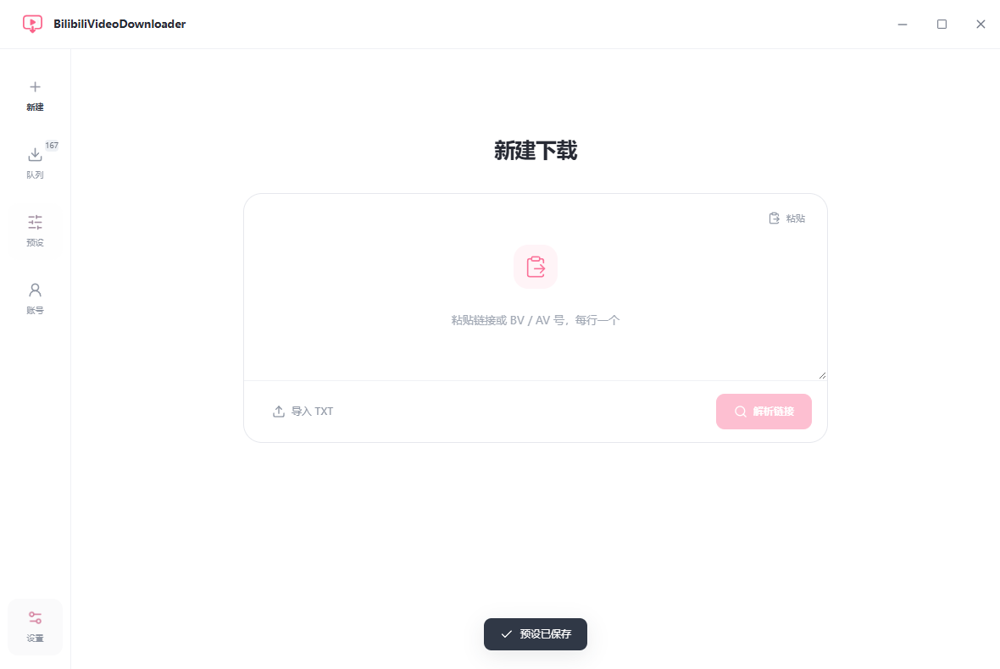
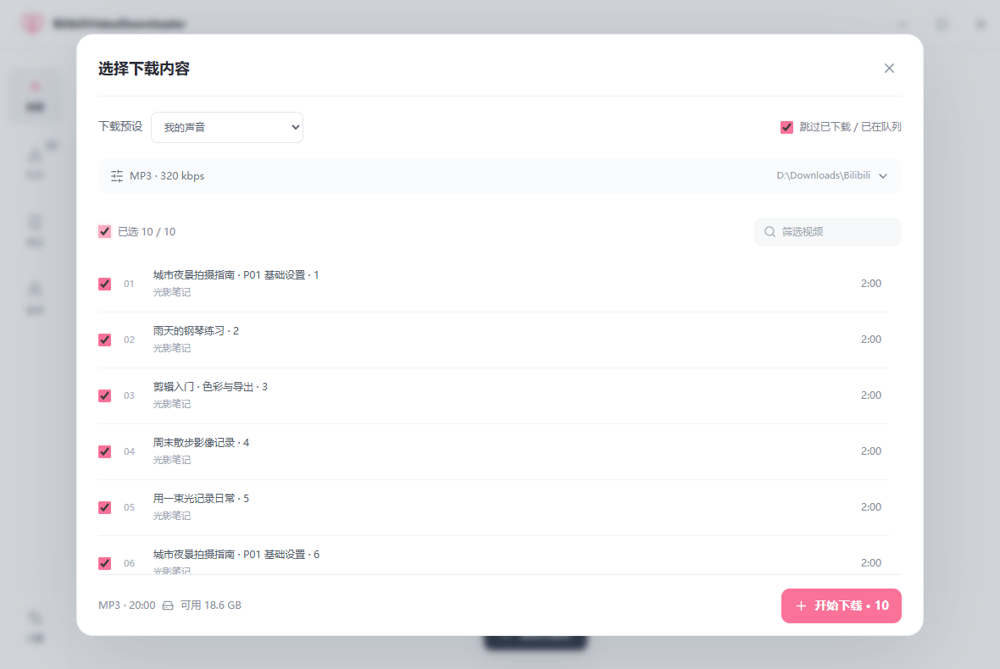
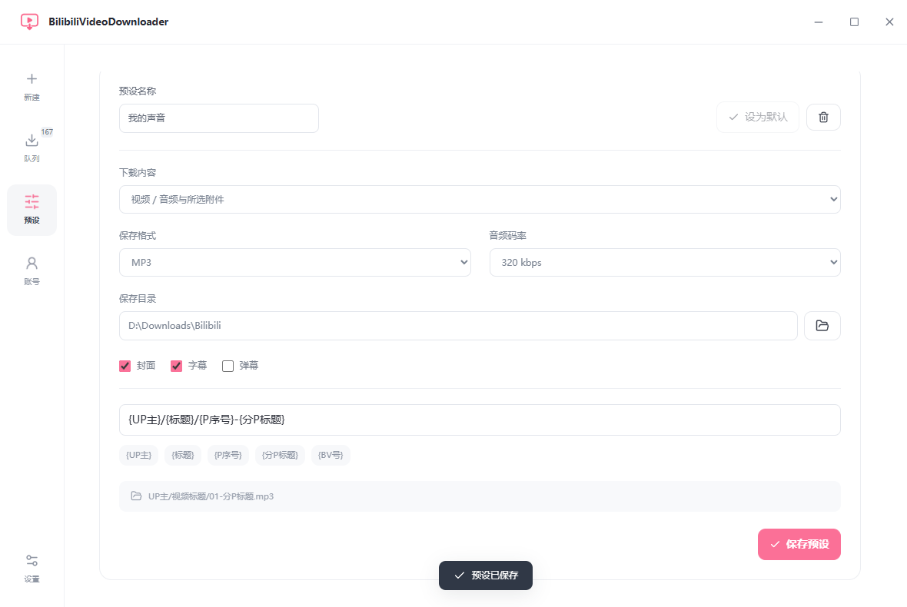
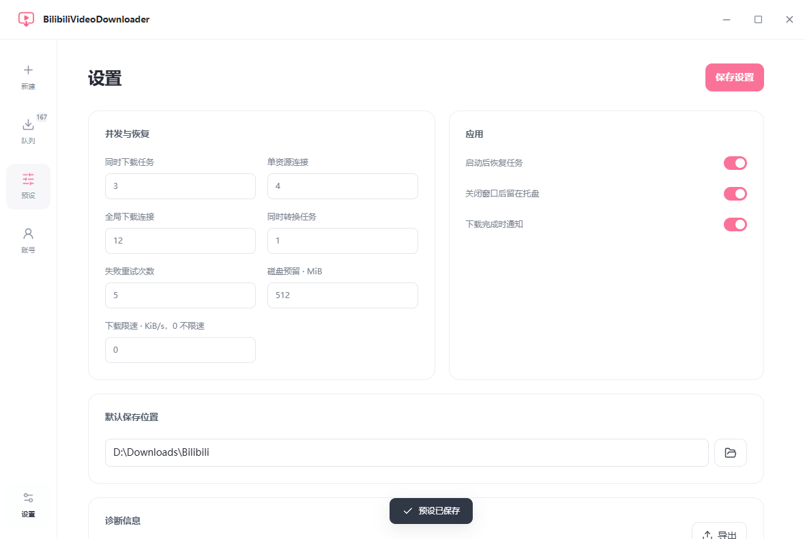

<div align="center">


# BilibiliVideoDownloader

### 哔哩哔哩视频与音频批量下载器

**把喜欢的视频，稳稳留在本地。**


[](LICENSE)

批量下载 · 校验续传 · 独立转码 · 扫码登录

**Windows v0.1.1** · [下载 Windows x64 版](https://github.com/BeamusWayne/bilibili-video-downloader/releases/tag/v0.1.1) · [Windows 使用说明](docs/windows.md)

**新版界面测试版 v0.2.0-beta.2** · [Windows 与 macOS 下载](https://github.com/BeamusWayne/bilibili-video-downloader/releases/tag/v0.2.0-beta.2)

**macOS v0.2.0-beta.1** · [下载 Apple 芯片 / Intel DMG 测试版](https://github.com/BeamusWayne/bilibili-video-downloader/releases/tag/v0.2.0-beta.1) · [macOS 安装说明](docs/macos.md) · [English](README_EN.md)

[功能一览](#功能一览) · [桌面界面](#桌面界面) · [快速开始](#快速开始) · [稳定性设计](#稳定性设计) · [相关项目](#相关项目) · [开发指南](docs/development.md)

</div>

---

## 功能一览

| 能做什么          | 使用体验                                                                     |
| ----------------- | ---------------------------------------------------------------------------- |
| 📥 **批量下载**   | 多行链接、BV / AV 或 TXT；解析弹窗中勾选内容，点击「开始下载」入队           |
| 🔄 **校验续传**   | 4 MiB 分片逐片校验，暂停、断网或异常结束后恢复已确认进度                     |
| 🎞️ **多格式导出** | MP4、MKV、MP3、M4A、FLAC、WAV；内置 FFmpeg / FFprobe                         |
| 🚦 **并发调度**   | 下载任务、每文件连接、总连接与转码分别限流，支持全局限速                     |
| 📱 **账号管理**   | 扫码或导入 Cookie，Windows 凭据管理器 / macOS 钥匙串保存登录态，本地缓存头像 |
| 🗂️ **本地整理**   | 按 UP 主和分 P 命名，支持封面、字幕、弹幕及附件单独保存                      |
| ✂️ **画面处理**   | 框选区域修补、模糊或裁切，先预览再导出，可保留原片                           |

单视频、多 P、短链接可直接解析。收藏夹、合集、UP 主空间、稍后再看、番剧、课程等入口依赖内置 yt-dlp、站点接口和账号访问权限，尚未逐项完成真实账号验证。

## 桌面界面


白色工作台配少量 B站粉，状态用颜色区分。白色顶栏集成窗口控制，账号单独管理，设置固定在左下角。

<details>
<summary><b>新建下载 → 解析弹窗 → 下载队列</b></summary>





</details>

截图中的任务、数值与进度均为演示数据。

## 快速开始

1. 从 [Releases](https://github.com/BeamusWayne/bilibili-video-downloader/releases) 下载安装包，或解压便携 ZIP。
2. 在「账号」扫码登录，或导入已有 Cookie。
3. 在「新建下载」粘贴链接，点击「解析链接」。
4. 在弹窗勾选分 P，按需调整格式、画质与目录，点击「开始下载」。
5. 在队列中暂停、继续、重试，完成后直接打开文件。

**Windows：**需要 Windows 10 / 11 x64 和 WebView2。使用安装包无需安装 Node.js、Rust 或 FFmpeg。便携版需要保留同目录的 `tools` 与 `licenses`。

**macOS 测试版：**目标 macOS 13+，提供 Apple 芯片和 Intel 两种 DMG，拖入「应用程序」即可安装，工具已内置。当前没有 Developer ID 签名和 Apple 公证，首次打开可能受系统拦截，详见 [macOS 安装说明](docs/macos.md)。

默认保存到 `下载/Bilibili/UP主/主标题/分P序号-分P标题 [任务ID].扩展名`。建议先使用默认并发：**3 个下载任务、每文件 4 连接、总计 12 连接、1 个转码任务**。详见 [Windows 使用说明](docs/windows.md)。

## 稳定性设计

| 环节     | 处理方式                                                  |
| -------- | --------------------------------------------------------- |
| 持久化   | SQLite WAL 保存队列、设置、解析结果，按设置恢复未完成任务 |
| 分片恢复 | 写盘后记录长度与 SHA-256，恢复时校验旧分片                |
| 一致性   | 比对资源身份、长度、强 ETag / Last-Modified，源变化时重下 |
| 网络异常 | 有限重试、退避、地址刷新、限流冷却                        |
| 兼容性   | 无 Range 时单连接；错误范围响应直接拒绝                   |
| 输出校验 | 临时文件经 FFprobe 检查后发布，避免半成品冒充完成         |
| 大队列   | 虚拟列表与合并后的批量操作请求                            |

已通过本地故障模拟、500 项队列检查，以及真实视频 MP4 / MP3 导出和暂停续传验证。证据与未覆盖范围见 [TESTING.md](TESTING.md)，实现见 [架构说明](docs/architecture.md)。

未确认的当前分片会重下；无可靠验证器时安全重下；转码中断后重新转码，源缓存仍可复用。缓存手动清理，磁盘需同时容纳分片、合并缓存和最终文件。

## 纯白工作台与批量优化

- **预设**：保存格式、画质、码率、目录、附件和命名规则，选择一个作为默认值。
- **历史去重**：解析后默认跳过本地仍存在的已下载文件；分 P、输出格式及处理选项分别识别。换保存目录不会误当成新视频，文件已删除则允许补下。
- **空间保护**：解析弹窗显示目标磁盘余量；下载前估算缓存，下载和转码期间保留余量。空间不足会暂停任务，清理缓存或释放空间后继续。
- **解析器维护**：在设置中更新 yt-dlp，校验官方发布的 SHA-256 后切换，支持取消和恢复内置版本。FFmpeg 不受此更新影响。
- **操作**：Ctrl + Enter / macOS Command + Enter 解析链接，勾选后点击开始；暂停、继续与重试作用于当前筛选及所选任务。

<details><summary><b>预设与设置</b></summary>





</details>

## 与掉宝助手联动

在 [Bili Live Companion](https://github.com/BeamusWayne/bili-live-companion) 新版侧栏点击「下载回放 / 视频」，粘贴已发布的视频链接，点击「在下载器中确认」。下载器会被单实例唤起并打开解析弹窗，确认格式、目录和分 P 后再开始。

两款应用各自保存登录态，只传递公开 BV/AV 视频链接。直播间不会被误当成回放；回放尚未发布时，需要等待或自行提供相关视频。未安装下载器时，助手提供下载入口与复制链接兜底。协议与验证边界见 [联动说明](docs/companion.md)。

## 开发与构建

```powershell
git clone https://github.com/BeamusWayne/bilibili-video-downloader.git
cd bilibili-video-downloader
npm ci
npm run prepare:tools
npm run desktop
```

Windows 需要 Node.js、Rust MSVC stable、Visual Studio 2022 C++ Build Tools 和 WebView2。macOS 使用 Rust stable 与 Xcode Command Line Tools，同样运行以上命令。DMG 必须在 Mac 上构建，仓库已提供两个架构的 GitHub Actions。测试与打包见 [开发指南](docs/development.md)，版本变化见 [更新日志](CHANGELOG.md)。

## 相关项目

同一作者维护的两款独立工具，按使用场景选择：

| 项目                                                                                | 适用场景                                         | 下载                                                                                    |
| ----------------------------------------------------------------------------------- | ------------------------------------------------ | --------------------------------------------------------------------------------------- |
| [BilibiliVideoDownloader](https://github.com/BeamusWayne/bilibili-video-downloader) | 批量保存 B站视频与音频，支持校验续传和多格式导出 | [Windows x64](https://github.com/BeamusWayne/bilibili-video-downloader/releases/latest) |
| [Bili Live Companion](https://github.com/BeamusWayne/bili-live-companion)           | 直播掉宝任务守候、多账号进度追踪与奖励领取       | [桌面版与部署指南](https://github.com/BeamusWayne/bili-live-companion#快速开始)         |

## 账号与许可

Cookie 长期存于 **Windows 凭据管理器或 macOS 钥匙串**，解析器使用短期 Cookie 文件。头像、资料、数据库与媒体缓存在本机，源码仓库不包含这些数据。离线资料显示「登录状态待验证」。

代码采用 [MIT License](LICENSE)，内置工具保留各自许可，见 [第三方说明](THIRD_PARTY_NOTICES.md)。手动区域滤镜不能保证无痕修复；当前不含自动 AI 水印识别与直播录制。

参考 [bdl](https://github.com/Yuelioi/bdl) 的使用场景，下载与恢复引擎独立实现，尚未进行同条件长期对比。本项目是非官方工具，与 Bilibili 无隶属关系。

---

<div align="center">
  Made with ☕ by <a href="https://github.com/BeamusWayne">Beamus Wayne</a>
</div>
