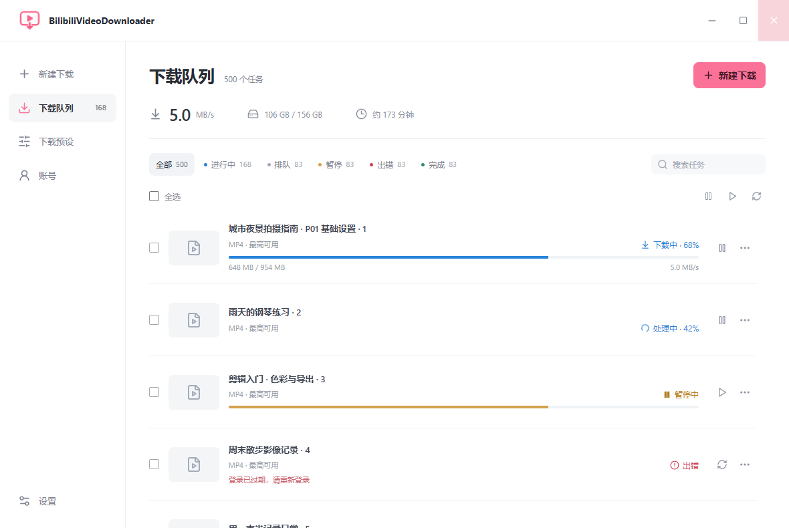

<div align="center">


# BilibiliVideoDownloader

### Keep the videos you love, reliably.


[](LICENSE)

**Batch downloads · Verified resume · Separate conversion workers · QR login**

[Windows downloads](https://github.com/BeamusWayne/bilibili-video-downloader/releases) · [简体中文](README.md)

</div>

## Features

- Paste multiple links or BV / AV IDs, or import a TXT list.
- Review parsed videos and parts in a dialog before starting downloads.
- Export MP4, MKV, MP3, M4A, FLAC and WAV with bundled FFmpeg / FFprobe.
- Control download workers, per-file connections, total connections and conversions separately.
- Resume verified 4 MiB chunks; reject inconsistent remote representations.
- Sign in with a QR code or import cookies. Windows Credential Manager stores credentials; avatars are cached locally.
- Save covers, subtitles and danmaku, and manually repair, blur or crop regions.



Single videos, multipart videos and short links are supported. Other Bilibili sources depend on yt-dlp, platform interfaces and account access; each source type has not been verified with a live account.

## Getting started

Requires Windows 10 / 11 x64 and Microsoft Edge WebView2. Get the installer or portable ZIP from [Releases](https://github.com/BeamusWayne/bilibili-video-downloader/releases). Keep the portable application's `tools` and `licenses` folders alongside its executable.

Sign in, open **New download**, paste links and parse. Select entries and output options in the dialog, then start downloading. The app switches to the queue.

Defaults: 3 download workers, 4 connections per file, 12 total connections and 1 conversion worker.

## Reliability

SQLite WAL persists tasks. SHA-256 checkpoints, ETag / Last-Modified and resource sizes help validate resumed data. Retries are bounded, rate limits trigger cooldowns, and final outputs are checked with FFprobe.

Unfinished chunks restart. Sources without reliable validators restart safely. Interrupted conversions restart conversion while retaining source files. Cache cleanup is manual.

Local fault tests, a simulated 500-task UI and real MP4 / MP3 exports have passed. This is not a benchmark against other downloaders. See [verification](TESTING.md) and [architecture](docs/architecture.md).

## Development

```powershell
git clone https://github.com/BeamusWayne/bilibili-video-downloader.git
cd bilibili-video-downloader
npm ci
npm run prepare:tools
npm run desktop
```

Requires Node.js, Rust MSVC, Visual Studio C++ Build Tools and WebView2. See the [development guide](docs/development.md), [Windows guide](docs/windows.md) and [changelog](CHANGELOG.md).

## License

Source: [MIT](LICENSE). Bundled tools retain their own licenses; see [third-party notices](THIRD_PARTY_NOTICES.md). Unofficial and unaffiliated with Bilibili. Region filters cannot guarantee invisible restoration. AI watermark detection and live-stream recording are not included.

<div align="center">Made with ☕ by <a href="https://github.com/BeamusWayne">Beamus Wayne</a></div>
