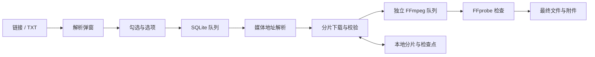

# 项目架构

[返回首页](../README.md)

## 模块

| 路径 | 职责 |
| --- | --- |
| `src/App.tsx` | 导航、白色窗口顶栏、输入、解析弹窗、队列、账号与设置 |
| `src/types.ts` / `src/styles.css` | 类型、默认值、样式与状态色 |
| `src-tauri/src/lib.rs` | IPC、单实例、托盘、预览和文件操作 |
| `model.rs` / `store.rs` | 数据、校验、路径和 SQLite WAL |
| `provider.rs` | B站元数据、yt-dlp、扫码、Cookie、头像资料 |
| `engine.rs` | 调度、恢复、下载、转换和附件的衔接 |
| `download.rs` | 连接门限、限速、Range、分片、哈希、重试和合并 |
| `media.rs` | FFmpeg 转换、区域滤镜和 FFprobe 检查 |
| `process.rs` | 隐藏子进程、超时、取消、脱敏和原子写入 |
| `src-tauri/tests/` / `scripts/` | 故障和媒体测试、界面检查、准备与打包 |

## 链路

新建页只负责输入。新解析清理上一轮内容，确认后才入队。批量操作合并为一次 IPC，由后端按状态过滤目标。

状态主要为 `queued → resolving → downloading → converting → completed`，可进入 `paused`、`error`、`cancelled`。启动按设置恢复排队或暂停。

## 并发与恢复

任务数、单文件分片、全局连接与转码分别限流。解析串行，限流时冷却，批量列表使用虚拟滚动。取消令牌传播到 HTTP 和子进程。

分片大小 4 MiB，写盘后记录长度和 SHA-256。恢复重新探测资源，对比 ID、大小和验证器，再逐片检查。源变化、无验证器、无 Range 时走安全重下或单流路径。合并缓存也有哈希，重新导出前验证。

转码生成临时文件，经检查后发布最终文件。转码不能从任意时间点续转，下载缓存可复用。

## 本地数据边界

Git 保存源码、文档、图标、锁文件与许可，不保存 Cookie、头像、数据库、媒体、预览、缓存、构建目录和工具 EXE。安装包通过 Releases 分发。

凭据长期存于系统凭据管理器；解析时使用临时 Cookie 文件。头像限制图片类型和大小，通过本地资源协议显示。缓存资料不代表已实时验证登录状态。

范围与验证记录见 [TESTING.md](../TESTING.md)。
